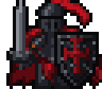

# Daedric Ledger: Bounties of Oblivion

A Skyrim Special Edition mod. The Daedric Princes have work for you. Take radiant tasks from eight princes, earn favor with each one, and play them against each other.

**Status: v0.2.0, early beta.** It passes every automated check in the build (Papyrus compile, plugin validation, byte-exact round trip, FOMOD schema) but has not been playtested in-game yet. 0.2.0 adds the King of Worms, a rival who is not a prince (see below). Expect rough edges and please report what you find. See [docs/TESTING.md](docs/TESTING.md).

- Game: Skyrim Special Edition / Anniversary Edition 1.6.x (also fine on 1.5.97). Works on Windows and on Linux through Proton.
- Requirements: none beyond the base game. No SKSE, no SkyUI, no DLC, no Creation Club content.
- Plugin: `BountiesOfOblivion.esp`, ESL-flagged, so it doesn't use a full load-order slot. Skyrim.esm is the only master.
- Optional faith mods: if you follow a prince in [Wintersun - Faiths of Skyrim](https://www.nexusmods.com/skyrimspecialedition/mods/22506) or carry their shrine blessing from [Pilgrim - A Religion Overhaul](https://www.nexusmods.com/skyrimspecialedition/mods/54099), that prince's tasks give +10 favor (0.2.0). Neither is required or a master. See [Faith mods](#faith-mods-wintersun-and-pilgrim).
- Compatible with [Blackshield Company](https://github.com/Blackshield-Company/blackshield-company): separate records, globals and prefixes (`BOO_` vs `BSC_`), and both use the vanilla radiant system so they never send you to the same reserved location at once.

## What it does

| Feature | How it works |
|---|---|
| The Ledger | Once you're level 5 and past the Helgen intro, a black book appears beside you after you sleep (or after a day of play if you never sleep). Read it and sign to get the lesser power **Consult the Daedric Ledger**. You can also cast the book away for good. |
| Tasks | Pick a prince in the Ledger and accept their task. One task at a time. Locations are picked by the game's radiant system from vanilla locations inside Skyrim's holds. |
| Mehrunes Dagon | Kill the leader of a bandit or Forsworn camp. |
| Boethiah | Defeat a named champion waiting near a dungeon. |
| Namira | Clear a draugr crypt. |
| Molag Bal | Destroy the master of a vampire lair. |
| Clavicus Vile | Recover the Gilded Wager from the boss chest of a Dwemer ruin. |
| Hircine | Hunt a named bear or sabre cat near an animal den or giant camp. |
| Sanguine | Drink three bottles of Sanguine's Revel Wine (he sends four) inside a chosen inn. |
| Vaermina | Retrieve the Shard of Nightmare from the boss chest of a warlock lair or hagraven nest. |
| Favor | 0 to 100 per prince, stored in globals. +20 per task, plus `150 + 10 × level` gold. Abandoning a task costs 10. |
| Rivalries | Dagon/Boethiah, Namira/Clavicus Vile, Molag Bal/Hircine, Sanguine/Vaermina. Each task costs 10 favor with the rival. |
| Blessings | At 30 favor a prince grants an ability (for example *Blessing of Boethiah*: Health +20). It's removed if favor falls below 30. |
| Gifts | At 80 favor a prince sends one enchanted ring or amulet (for example *Ember Torc of Dagon*: Destruction +12%). Once per prince. |
| The King of Worms (0.2.0) | Mannimarco, the lich, is a rival and not a prince. He has no favor, blessing or gift track and never offers tasks. Every finished task raises his **menace** (0 to 100): +15, or +25 for Namira and Molag Bal, whose trade in corpses and souls draws him. |
| The thrall hunt (0.2.0) | At 50 menace a worm-eaten page appears and the Ledger gains a *The King of Worms* button. Accept the hunt to kill his thrall (a necromancer boss near a dungeon). It counts as your one task. Slaying it pays the usual gold and resets the menace to 0. Abandoning the hunt costs no favor, and the menace stays where it is. |
| Gnawed pages (0.2.0) | Ignore him until menace hits 100 and every prince task gives only half its favor until you hunt a thrall down. |
| Amulet of the Worm's Bane (0.2.0) | A one-time gift for the third thrall slain: Restoration +15%, a vanilla silver necklace. |

Namira was already one of the eight princes before 0.2.0 (clear a draugr crypt, rival of Clavicus Vile, *Blessing of Namira*, *Necklace of the Hollow*). 0.2.0 doesn't add her again. Her tasks now also draw the King of Worms.

Everything reuses vanilla assets: jewelry, gem, gyro and wine-bottle meshes, vanilla magic effects, and leveled bandit, bear, sabre cat and necromancer templates. There is no new voice acting. The princes speak through the Ledger and message boxes.

## Faith mods: Wintersun and Pilgrim

Since 0.2.0 the Ledger notices worship from two religion mods. Both are optional soft integrations: the plugin keeps Skyrim.esm as its only master, nothing is patched in either mod, and without them nothing changes.

| Mod | What counts as worship | Effect |
|---|---|---|
| Wintersun - Faiths of Skyrim | You follow the prince (Follower or Devotee) | +`BOO_FaithBonus` (10) favor on each of that prince's tasks |
| Pilgrim - A Religion Overhaul | You carry the prince's shrine blessing (*Cultist of ...*) | Same |

Rivals still take their usual cut, and the King of Worms' half-favor penalty is applied before the bonus. What it does not do: it doesn't raise or lower your Wintersun favor or follow tenets, it doesn't change Pilgrim's blessings, and worshipping Mannimarco in either mod doesn't affect the King of Worms. Doing those would need a hard master or SKSE.

## Install

Grab `BountiesOfOblivion-<version>.zip` from [Releases](https://github.com/Blackshield-Company/bounties-of-oblivion/releases) (it's a FOMOD installer).

- **Mod Organizer 2**: *Install a new mod from an archive*, pick the zip, then enable `BountiesOfOblivion.esp` in the right pane.
- **Vortex**: drag the zip into the Mods page, install and enable it.
- **Manual (Linux/Proton, no mod manager)**: copy everything inside `00 Core/` from the zip into `.../steamapps/common/Skyrim Special Edition/Data/`. Then add the line `*BountiesOfOblivion.esp` to
  `.../steamapps/compatdata/489830/pfx/drive_c/users/steamuser/AppData/Local/Skyrim Special Edition/Plugins.txt`.

It's safe to add to an existing save. Uninstalling mid-playthrough is not recommended, as with any scripted mod.

## Console tunables

```
set BOO_IntroMinLevel to 5    (level before the Ledger can arrive)
set BOO_PayMult to 1.0        (multiplier on task gold)
set BOO_FavorGain to 20       (favor per completed task)
set BOO_RivalLoss to 10       (favor the rival loses per task)
set BOO_WormGain to 15        (King of Worms menace per task)
set BOO_WormDeathGain to 25   (menace per Namira or Molag Bal task instead)
set BOO_WormThreshold to 50   (menace at which he sends a thrall)
set BOO_FaithBonus to 10      (extra favor when you worship the prince; 0 turns it off)
```

## Build from source

The release zip is built entirely from this repo by `./build.sh` on Linux:

1. **Papyrus**: `src/papyrus/*.psc` are compiled to `.pex` with the open-source [papyrus-compiler](https://github.com/russo-2025/papyrus-compiler) (MIT, native Linux). The build downloads it and verifies its checksum. It type-checks against clean-room API declarations in `tools/modkit/papyrus-stubs`.
2. **Plugin**: `src/plugin/BountiesOfOblivion.Generator` is a C# program that uses [Mutagen](https://github.com/Mutagen-Modding/Mutagen) to write `BountiesOfOblivion.esp` from code. It then re-reads the plugin and validates it: ESL range, masters, dangling links, every script property against the `.psc` sources, quest text tags against aliases and text globals, and a byte-exact round trip.
3. **FOMOD**: `tools/modkit/fomod/pack.py` validates `fomod/ModuleConfig.xml` against the FOMOD schema and writes a reproducible zip to `dist/`.

Requirements: .NET SDK 9 or newer, python3, curl, and optionally `xmllint` (libxml2) for the schema check. No Creation Kit or Wine needed.

```bash
./build.sh
# Optional: type-check the scripts against your game's own sources
# (unpack Data/Scripts.zip from your install first):
./build.sh -H "/path/to/Skyrim Special Edition/Data/Source/Scripts"
```

`src/plugin/formids.json` pins every record's FormID. Never edit or reuse entries, or existing saves will break.

## Layout

```
src/papyrus/                 Papyrus sources (.psc)
src/papyrus-headers/         Compile-time declarations for optional mods (not shipped)
src/plugin/                  Mutagen plugin generator + pinned FormIDs
fomod/                       FOMOD installer config (info.xml, ModuleConfig.xml)
docs/                        Testing checklist, design notes, Nexus page and upload fields
tools/modkit/                Shared tooling for the mod series (copied from Blackshield Company, extended)
build.sh                     One-command build
```

## Support

Donations are optional. Nothing in the mod is gated on them.

- GitHub Sponsors: https://github.com/sponsors/synthalorian
- Ko-fi: https://ko-fi.com/synthalorian

## Credits and licenses

- Code in this repo: MIT (see `LICENSE`).
- [Mutagen](https://github.com/Mutagen-Modding/Mutagen) by Noggog and contributors (GPL-3.0). It's used as a build tool and isn't redistributed.
- [papyrus-compiler](https://github.com/russo-2025/papyrus-compiler) by russo-2025 (MIT). It's downloaded at build time.
- FOMOD schema from [GandaG/fomod-schema](https://github.com/GandaG/fomod-schema) (MIT).
- Skyrim and its assets belong to Bethesda Softworks. This repo contains no Bethesda assets or script sources. The plugin only references vanilla records by FormID and vanilla meshes by path.

## Support

Donations are optional. Nothing in the mod is gated on them.

- GitHub Sponsors: https://github.com/sponsors/synthalorian
- Ko-fi: https://ko-fi.com/synthalorian

<p><br><sub>A <a href="https://github.com/synthalorian">Blackshield Company</a> mod.</sub></p>
